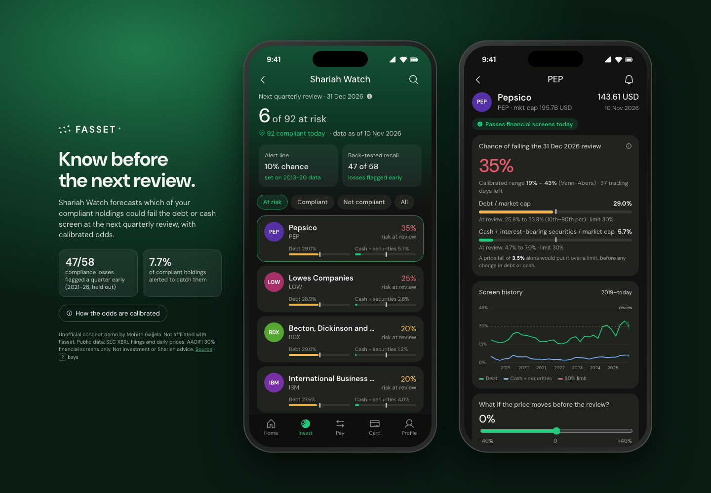

# Shariah Watch for Fasset

**Live demo:** https://mohith26.github.io/fasset-shariah-watch/

Fasset's own guide to halal investing says compliance "is not a one-time certification" and that a good platform "notifies you when a previously compliant stock changes status". Today every screener (Zoya, Musaffa) tells you *after* a stock fails. Shariah Watch tells you **before the next quarterly review**: for each compliant holding it gives a calibrated probability of failing the AAOIFI debt or cash screen, with a Venn-Abers range, the price fall that would break it, and a what-if slider. It is built as a screen in the Fasset app (Invest tab), next to Strategies.



*Unofficial concept demo by Mohith Gajjela. Not affiliated with Fasset. Public data: SEC XBRL filings and daily prices. Not investment or Shariah advice.*

## Results (held out, computed by `scripts/build_data.mjs`, stored in `data/results.json`)

Every quarter-end review from 2013 to mid-2026 for 154 large US non-financial stocks, screened from SEC filings as they were known on that date. Reviews through 2020 (3,907) calibrate; 2,662 reviews from 2021-03-31 to 2026-06-30 are held out.

| Held-out metric | Value |
|---|---|
| Compliant holdings that failed the next review | 58 of 1,815 (3.2%) |
| **Flagged a quarter early (risk ≥ 10%)** | **47 of 58** |
| Compliant holdings alerted | 7.7% |
| Alerts that really failed | 33.6% (vs 3.2% base rate) |
| AUC among compliant holdings | 0.920 |
| Brier: Venn-Abers / raw simulation / "status stays the same" | 0.0350 / 0.0329 / 0.0451 |

The 10% alert line was chosen on 2013-2020 data only (max F1). As of 10 Nov 2026, 6 of 92 compliant stocks are above it for the 31 Dec 2026 review: PEP, LOW, BDX, IBM, ZTS, CRM.

Honest note: on the held-out years the raw simulation has a slightly better Brier score than the Venn-Abers output; Venn-Abers is used for its finite-sample calibration guarantee and the [p0, p1] range, not because it scores better here.

## How it works

1. **Screens** (`core/watch.js`): AAOIFI Standard 21 financial screens: interest-bearing debt / market cap < 30% and cash + interest-bearing securities / market cap < 30%. Debt and cash come from SEC XBRL `companyfacts` using only filings made by the review date (latest period, latest restatement). Market cap = unadjusted close (Yahoo split events undone) × latest reported shares.
2. **Forecast:** 600 Monte Carlo paths per review (4,000 for the live list): the price over the remaining trading days by 3-day block bootstrap of the last two years of daily log returns; debt and cash by resampling the company's own last 12 quarter-on-quarter changes (winsorised at ±1 log unit, since bigger jumps are almost always XBRL tag changes) plus small noise.
3. **Calibration:** inductive Venn-Abers prediction (Vovk & Petej 2014) on the 2013-2020 reviews: isotonic regression refit with the test score labelled 0 and 1 gives [p0, p1]; the shown probability is p1 / (1 − p0 + p1).
4. **Strategy view:** the number of compliant names expected to drop out at the review (exact Poisson-binomial over the calibrated probabilities, assuming independence), for rebalancing built-in strategies like S&P 500 Shariah.
5. **App:** the Fasset app shell (DM Sans, dark cards, green accents, Strategies-style cards). Left phone: watchlist with filters (At risk / Compliant / Not compliant / All), search, CSV export. Right phone: the holding's calibrated risk and range, ratio bars with the 30% line and the 10th–90th percentile at the review, quarterly screen history with the forecast fan, a price what-if slider (model estimate), alert toggle (persisted in localStorage), JSON export. Deep links: `#t=PEP&f=risk&shock=-10`. Keys: ↑/↓, 1-4, /, N, ←/→, E, J, H, ?.

## Tests

`node --test tests/core.test.mjs` (14 tests, run by GitHub Actions): data integrity, the 30% limits, split un-adjustment, point-in-time balance sheets (no look-ahead, restatements), isotonic monotonicity, Venn-Abers bounds and shrinking range (randomized), Venn-Abers calibration on a synthetic problem (randomized), simulation determinism and extremes, monotonicity in the price shock (property), breaking-drop algebra, AUC/Brier, **every stored probability is reproduced by the app's pipeline**, **the headline numbers are recomputed from `backtest.json`**, and the at-risk list matches the threshold.

## Run it

```
python3 -m http.server             # open http://localhost:8000
python3 scripts/fetch_data.py      # re-download SEC + price data into raw/ (about 3 min, not committed)
node scripts/build_data.mjs        # rebuild data/*.json (about 10 s)
node --test tests/core.test.mjs
```

## Limitations

- Only the two balance-sheet screens are modelled. The business-activity screen and the 5% impure-income screen (Fasset gets these from its Shariah screening partner) are not, so "compliant" here means "passes the financial screens".
- Market cap uses the spot price; S&P and Dow Jones Shariah indices use 24- or 36-month average market caps, which would make the forecast smoother (easy to add).
- XBRL tagging varies by company; some stocks (and some quarters) are dropped when debt or cash cannot be read, and a few tag switches remain as noise.
- Venn-Abers guarantees assume past and future reviews are exchangeable; a regime change (e.g. 2022 rate shock) can break that. The reliability table in the app shows where it under-predicts (10-20% bin).
- The price what-if conditions on a fixed price move, so its odds are model estimates, not calibrated.

## Prior art / novelty

Zoya and Musaffa (Fasset's screening partner since Jan 2026) show current status, methodology switches and change alerts after a status changes. Fasset's blog lists "notifies you when a previously compliant stock changes status" as a platform requirement. I found no screener or broker offering a forward-looking, calibrated probability of failing the next review. Checked: fasset.com blog (halal asset classes, Shariah-compliant platform, best halal platforms 2026, Musaffa partnership), Zoya help center and API reference, Musaffa screening methodology and business API pages, searches for "Shariah compliance prediction next quarter", "become non-compliant forecast".

## Data

SEC EDGAR XBRL `companyfacts` API (public); Yahoo Finance chart API (daily closes and split events).
